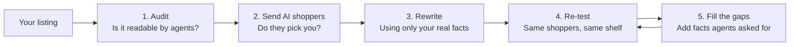
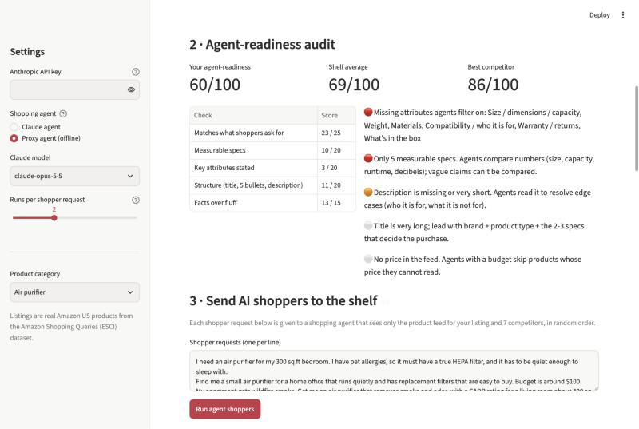
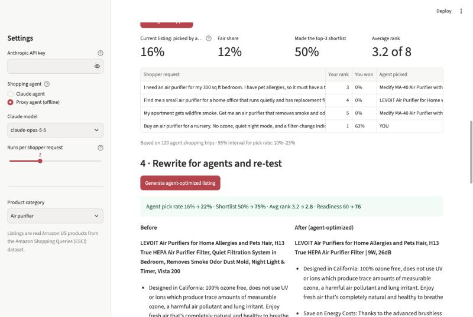
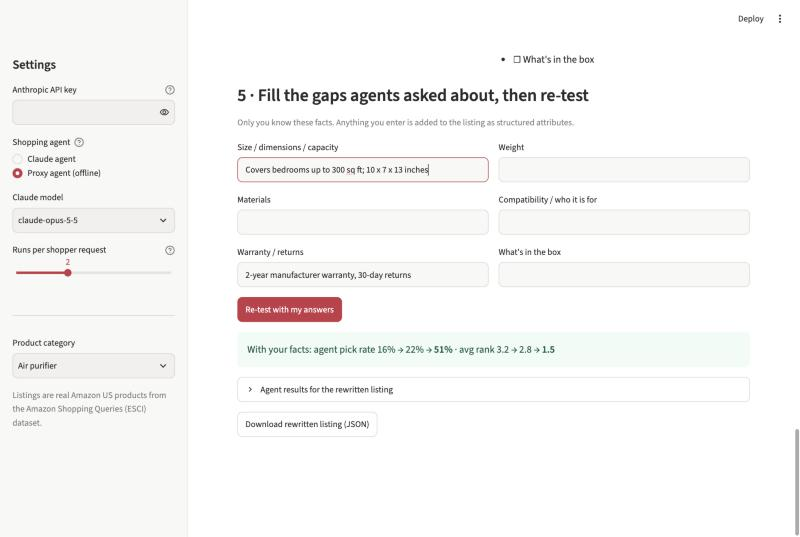
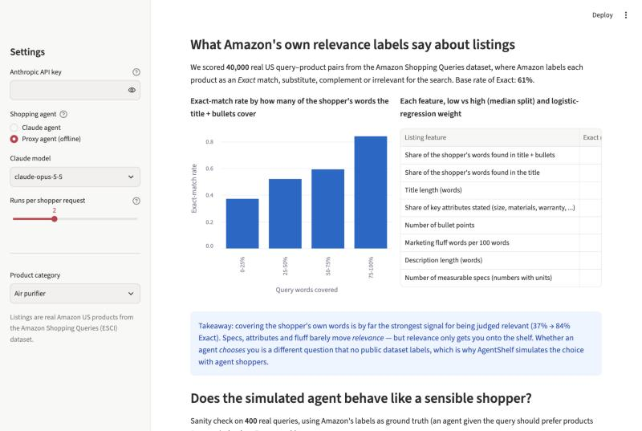

# AgentShelf

**Get your Amazon product picked when the shopper is an AI agent.**

*UCLA Anderson MSBA Vibathon 2026 · Theme 02: When the customer is a bot*

---

## The problem in one minute

More and more purchases now start with a person telling an AI assistant what they want ("find me a quiet air purifier for my bedroom, I have pet allergies"), and end with the assistant choosing the product and checking out. In January 2026 Google launched an open standard that lets AI agents shop across stores, and Microsoft added checkout inside Copilot.

The AI agent **never sees your ads, your photos or your brand story.** It reads the product data: the title, bullet points, description, attributes and price. Then it decides.

For a **small Amazon seller** this creates a new, invisible problem:

- They lose sales without knowing it. No dashboard shows "an AI looked at your product and chose a competitor."
- They don't know *why*. Was it a missing spec? Vague wording? A fact the shopper asked for that the listing never mentions?
- Their usual tools stop working. Ads, A/B tests on the product page and conversion funnels all assume a human is looking.

## What AgentShelf does

AgentShelf is a testing lab for your listing. It puts your product on a virtual shelf next to real competitors, sends AI shoppers to buy from that shelf, and tells you how often they pick you, why they pass on you, and what to change.



| Step | What the seller sees | Why it matters |
|---|---|---|
| **1. Audit** | A 0–100 "agent-readiness" score and a to-do list ("no warranty stated", "only 5 measurable specs", "marketing words agents ignore") | A quick checkup before spending anything |
| **2. Send AI shoppers** | How often AI shoppers chose you out of 8 products, your average rank, and **what each agent said about your product** in its own words | This is the number that turns into sales: your **agent pick rate** |
| **3. Rewrite** | A new title, bullets and a table of attributes, built only from facts already in your listing | Agents prefer clear, checkable facts. Nothing is made up |
| **4. Re-test** | Before vs after: pick rate, shortlist rate, rank | Proof the change worked, like an A/B test where the customer is a bot |
| **5. Fill the gaps** | A short form: the facts shoppers asked about that only you know (warranty, size, what's in the box) | Often the biggest win: agents can't choose what they can't verify |

### Example run (air purifier, offline mode)

| | Agent pick rate | Average rank (of 8) |
|---|---|---|
| Original listing (a real LEVOIT listing from Amazon) | 16% | 3.2 |
| After the rewrite | 22% | 2.8 |
| After the seller adds warranty and size facts | **51%** | **1.5** |

The fair share on a shelf of 8 products is 12.5%.

> These numbers come from the offline proxy agent and are meant to show the workflow. With an API key, the same flow runs with Claude as the shopping agent. See [Methodology](docs/METHODOLOGY.md) for how reliable the simulation is and where its limits are.

## Screenshots

| Audit | AI shoppers + rewrite |
|---|---|
|  |  |
| **Fill the gaps and re-test** | **Market evidence from Amazon data** |
|  |  |

## What the data tells us

We analyzed **40,000 real Amazon search–product pairs** from the Amazon Shopping Queries dataset, where Amazon labeled each product as an *Exact* match for the search, or not.

- **Using the shopper's own words is the strongest signal.** Listings whose title and bullets covered 75–100% of the words in the search were judged Exact **84%** of the time. Listings covering 0–25% were judged Exact only **37%** of the time.
- **But being relevant only gets you onto the shelf.** Whether an agent then *chooses* you over seven other relevant products is a question no public dataset answers. That gap is why AgentShelf simulates the choice instead of guessing.

## Who it's for and why it's worth paying for

- **User:** an independent Amazon seller with 1–20 products who can't afford an agency.
- **Value:** a new KPI they can act on (agent pick rate), a concrete to-do list, and proof that changes worked before they publish them.
- **Business model idea:** a per-product subscription ($19–49/month) that monitors agent pick rate as competitors and agents change, sold through Amazon/Shopify service-provider marketplaces.

## Try it

You need Python 3.10+. An Anthropic API key is optional. Without one, the app uses a built-in offline shopping agent, so the demo always runs.

```bash
git clone <this repo> && cd agentshelf
python3 -m venv .venv && .venv/bin/pip install -r requirements.txt
.venv/bin/streamlit run app.py
```

Open http://localhost:8501. To use Claude as the shopping agent, paste an API key in the sidebar, or run `export ANTHROPIC_API_KEY=...` before starting.

The processed data (`data/markets.json`, `data/insights.json`, `data/validation.json`) is included, so you don't need to download anything to run the app. To rebuild it from the raw dataset, see [Methodology → Reproducing the data](docs/METHODOLOGY.md#9-reproducing-everything).

## Learn more

| Document | For | What's inside |
|---|---|---|
| [docs/WORKFLOW.md](docs/WORKFLOW.md) | Everyone | The seller's journey step by step, plus a 3-minute demo script |
| [docs/METHODOLOGY.md](docs/METHODOLOGY.md) | Technical readers, judges | Data, scoring formulas, agent simulation design, validation results, limits, FAQ |

## Repository map

```
app.py            Streamlit app (the five-step workflow + evidence + how it works)
engine.py         Audit, offline proxy agent, Claude shopping agent, rewrite
build_data.py     Builds category shelves and the statistical analysis from the ESCI dataset
validate.py       Checks the agents against Amazon's labels (does the agent pick the right product?)
tests/            Unit tests (no API key needed): .venv/bin/python -m pytest -q
data/             Processed data used by the app (raw dataset is not committed)
docs/             Workflow, methodology, screenshots
```

## Honest limits

- Our simulated agents are **not** the actual Google, Amazon or Microsoft shopping agents. Results show direction and relative improvement, not an exact market share.
- Rewrites must be reviewed by the seller before publishing. The tool is designed never to invent facts, and anything missing goes to the seller's to-do list instead.
- The public dataset has no prices or reviews, so this prototype judges products on listing content only.

---

Data: [Amazon Shopping Queries Dataset (ESCI)](https://github.com/amazon-science/esci-data), Apache-2.0, Reddy et al. 2022.
